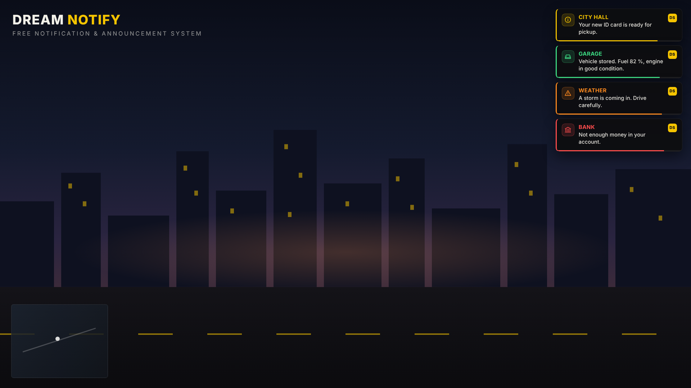
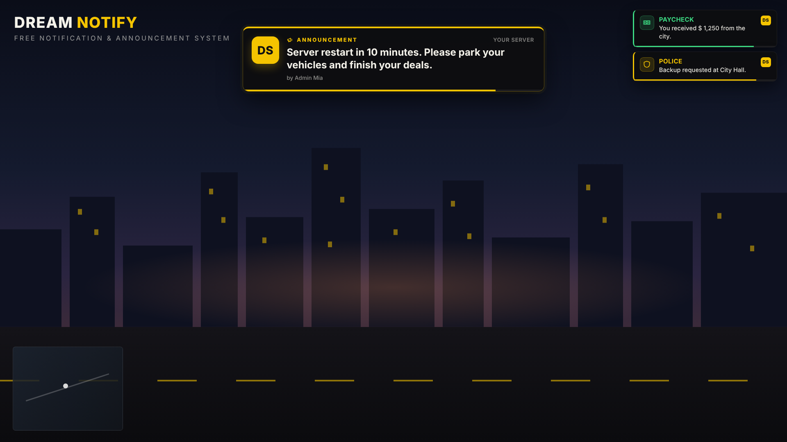
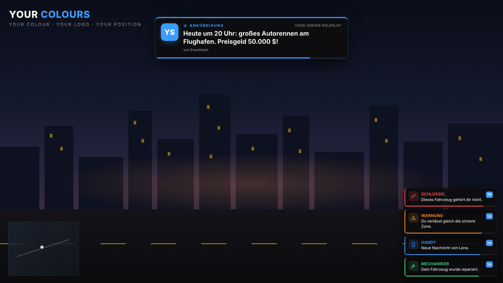

# Dream Notify (free)


A notification and announcement system for roleplay servers. Small toasts stack in a corner of the screen, each with an icon, a title and a progress bar. Admins can send a larger banner to all players with `/announce`.

Free, with the full source code: no escrow, no obfuscation, no database, no webhooks, no audio or image files. ESX Legacy is supported but not required.

**Languages: English (default) and German**, set with `Config.Locale`. All texts are in `locales.lua`.

Trailer: https://youtu.be/-HtcchTnKsk · Questions and bug reports: https://discord.gg/2cAK4XMzSe

| Toasts | Announcement banner (`/announce`) | Your own colours and logo letters |
|---|---|---|
|  |  |  |

The animation and the pictures are made with the included `preview.html` (drawn background, sample texts). They are not in-game recordings.

## Install in 3 steps

1. Click **Code → Download ZIP**, unpack it and name the folder `dream_notify` (GitHub adds `-main` to the name; remove that). Move the folder into the `resources` folder of your server.
2. Add this line to your `server.cfg` (with ESX: below `ensure es_extended`):
   ```
   ensure dream_notify
   ```
3. Restart the server. In game, type `/notifytest`. Four toasts appear: it works.

No database, no other resource needed. Settings (language, position, colours) are in `config.lua`; details below.

## Complete example

Copy this into the server side of your own resource. It sends a toast with every field and falls back to a chat line if Dream Notify is not running.

```lua
-- server side, in your own resource
local function notifyPlayer(playerId, title, message, kind, icon)
    if GetResourceState('dream_notify') ~= 'started' then
        TriggerClientEvent('chat:addMessage', playerId, { args = { title, message } })
        return false
    end
    return exports['dream_notify']:Notify(playerId, {
        title    = title,
        message  = message,
        type     = kind or 'info',  -- 'info' | 'success' | 'warning' | 'error'
        duration = 6000,            -- milliseconds
        icon     = icon,            -- optional, see "Icons" below
    })
end

-- inside one of your server events, for example after a salary payment:
-- notifyPlayer(source, 'Paycheck', 'You received $1,250.', 'success', 'money')
```

`Notify` returns `true` when the toast was sent and `false` when the player is offline or the text is empty or invalid. All other exports and events are listed under "Usage" and "Exports and events".

**Tested with:** Lua 5.4 against a mock of the server and client functions (45 server checks, 30 client checks including the ESX group check and the ESX override, all passed on 13 Nov 2026) and the interface in headless Chrome 153 (preview runs without errors). **Not yet run or measured on a live game server and not yet with a real ESX Legacy install.** If you run it, please tell us in Discord how it went.

## Features

- Toasts in four types: `info`, `success`, `warning`, `error`
- Progress bar that shows how long a toast stays
- Six positions: top or bottom, each left, center or right
- Maximum number of visible toasts; more wait in a queue
- Short generated sound per type, can be switched off
- Respects "reduced motion" (no sliding when Windows animations are off, or by config)
- Theme in `config.lua`: primary colour, background, text colour, server name
- Logo badge built from 1-3 letters of your choice (default `DS`), no image needed
- Announcement banner for all players: `/announce <text>`
- Permission by ESX group or ACE, cooldown, length limit, text cleaning, all checked on the server
- 23 built-in icons
- Never takes mouse or keyboard focus

## Requirements

- None.
- Optional: es_extended (ESX Legacy). With ESX, the groups in `Config.Announce.groups` may use `/announce`.

## Installation (all steps)

1. Put the folder `dream_notify` into your `resources` folder. Do not rename it.
2. Add `ensure dream_notify` to your `server.cfg`. With ESX, put it after `es_extended`.
3. Edit `config.lua` (language, position, colours, logo letters, announce groups).
4. Restart the server. In game, type `/notifytest` to see one toast of every type.

Without ESX, give your admins the announce permission in `server.cfg`:

```
add_ace group.admin dream_notify.announce allow
```

## Preview without a server

Open `preview.html` with a double click. It shows the real UI in your browser with buttons for every type, the banner, the position, the colour and the logo letters. Add `?shot=1` to the address to hide the buttons for screenshots.

## Usage

### Client side

```lua
exports['dream_notify']:Notify({
    title    = 'Garage',            -- optional
    message  = 'Vehicle stored.',
    type     = 'success',           -- 'info' | 'success' | 'warning' | 'error' (default 'info')
    duration = 5000,                -- ms, optional
    icon     = 'car',               -- optional, see the icon list
})

-- short form: message, type, duration, title
exports['dream_notify']:Notify('Vehicle stored.', 'success')

-- banner for this player only
exports['dream_notify']:Announce('Welcome to the city!')

-- remove everything from the screen
exports['dream_notify']:Clear()
```

`Notify` returns `true` when the toast was accepted and `false` when the input was empty, invalid or a duplicate.

### Server side

```lua
-- one player
exports['dream_notify']:Notify(source, { title = 'Bank', message = 'You received $500.', type = 'success', icon = 'money' })

-- all players
exports['dream_notify']:Notify(-1, { message = 'The city hall is open now.', type = 'info' })

-- banner for all players
exports['dream_notify']:Announce('Server restart in 10 minutes.')
exports['dream_notify']:Announce({ message = 'Car meet at the pier, 8 pm.', title = 'Event', sender = 'Event team', duration = 12000 })
```

If you do not want to call exports, the same works with local server events:

```lua
TriggerEvent('dream_notify:send', source, { message = 'Hello', type = 'info' })
TriggerEvent('dream_notify:sendAnnounce', 'Server restart in 10 minutes.')
```

From the server you can also send the client event directly:

```lua
TriggerClientEvent('dream_notify:show', source, { title = 'Job', message = 'You are on duty.', type = 'success' })
```

### Icons

`info`, `success`, `warning`, `error`, `megaphone`, `bell`, `money`, `bank`, `car`, `phone`, `mail`, `star`, `shield`, `user`, `heart`, `lock`, `key`, `wrench`, `clock`, `pin`, `gift`, `briefcase`, `medic`

Without `icon` (or with an unknown name) the icon of the type is used.

## Exports and events

| Side | Name | Arguments |
| --- | --- | --- |
| Client export | `Notify` | table `{ title, message, type, duration, icon }` or `message, type, duration, title` |
| Client export | `Announce` | text or table `{ message, title, sender, duration }` |
| Client export | `Clear` | none |
| Server export | `Notify` | `target` (player id or `-1`), then the same as the client export |
| Server export | `Announce` | text or table, optional `target` (default: all players) |
| Server event (local) | `dream_notify:send` | `target`, data |
| Server event (local) | `dream_notify:sendAnnounce` | data, optional `target` |
| Client event | `dream_notify:show` | data (sent by the server) |
| Client event | `dream_notify:announce` | data (sent by the server) |
| Client event | `dream_notify:clear` | none |

`description` and `text` are accepted as other names for `message`. The types `inform`, `warn` and `danger` are understood too.

## Commands

- `/announce <text>`: banner for all players. Allowed for the ESX groups in `Config.Announce.groups`, for players with the ACE permission in `Config.Announce.ace`, and for the server console.
- `/notifytest`: shows four sample toasts to the player who typed it. Remove it with `Config.TestCommand = ''`.

## Configuration (config.lua)

| Option | Meaning |
| --- | --- |
| `Config.Locale` | `'en'` or `'de'` |
| `Config.Position` | `top-right`, `top-left`, `top-center`, `bottom-right`, `bottom-left`, `bottom-center` |
| `Config.OffsetX`, `Config.OffsetY` | Distance to the screen edge (pixels at 1080p) |
| `Config.Scale` | Size of the UI (0.6 - 1.6) |
| `Config.MaxVisible`, `Config.MaxQueue` | Visible toasts at once, waiting toasts |
| `Config.DefaultType`, `Config.DefaultDuration`, `Config.MinDuration`, `Config.MaxDuration` | Defaults and limits |
| `Config.DefaultTitles` | Give toasts without a title the name of their type |
| `Config.MaxTitleLength`, `Config.MaxMessageLength` | Longer texts are cut |
| `Config.StripColorCodes` | Remove codes like `~r~` and `^1` |
| `Config.DedupeMs` | Ignore the same toast arriving twice within this time |
| `Config.Sound` | `enabled`, `volume` |
| `Config.ReducedMotion` | Never slide, only fade |
| `Config.Theme` | `primary`, `background`, `text`, `logoText` (1-3 letters), `serverName`, `showBadge` |
| `Config.Colors` | Colour per type; `''` uses the primary colour |
| `Config.EsxOverride` | Show ESX notifications with this script (see below) |
| `Config.TestCommand` | Name of the test command, `''` = none |
| `Config.Announce` | `enabled`, `command`, `groups`, `ace`, `cooldown`, `minLength`, `maxLength`, `duration`, `position`, `showSender`, `sound`, `log` |

## ESX override (optional)

By default ESX keeps its own notifications. To show them with Dream Notify:

1. Set `Config.EsxOverride = true`.
2. Stop the resource `esx_notify` (remove its `ensure` line), but leave its folder in `resources`.
3. Restart the server.

What happens then: notifications the server sends through ESX (`xPlayer.showNotification`) are shown by Dream Notify. Client scripts that call `ESX.ShowNotification` are picked up on ESX versions that still forward the call to `exports['esx_notify']` while that resource is stopped; Dream Notify answers this export. If the same text arrives on both ways, it is shown once.

This part depends on the ESX version and could not be tested on every version. If some client notifications do not appear on your server, open `es_extended/client/functions.lua`, find `function ESX.ShowNotification` and replace its body with the line below (use the parameter names of your function; in older versions the second one is called `type`):

```lua
exports['dream_notify']:Notify(message, notifyType, length, title)
```

## Security

- The server file registers no network event. Players cannot trigger anything on the server through this script.
- `/announce` checks permission, cooldown and text on the server. The client is never asked.
- Every text is cleaned in Lua (type, length, control characters) and written to the page as plain text. HTML inside a notification is shown as characters and is never run.
- No webhooks, no HTTP requests, no remote code, no files written.

## FAQ

**Nothing shows up.** Type `/notifytest`. If you see four toasts, the script works and the other script is not calling it. Check the F8 console for errors and make sure the folder is named `dream_notify`.

**`/announce` says I am not allowed.** With ESX your group must be in `Config.Announce.groups` (check it with your admin tool). Without ESX add the ACE line from the installation section to `server.cfg`.

**Another script already uses `/announce`.** Change `Config.Announce.command`, for example to `dannounce`.

**My announcement was cut at a semicolon.** Chat commands are split at `;`. Use a comma or a dash instead.

**I hear no sound.** Check `Config.Sound.enabled` and the volume. The sound is quiet on purpose.

**Can I use my logo image instead of letters?** Not in this version. The badge is built from the letters in `Config.Theme.logoText`.

**The toasts cover my HUD.** Change `Config.Position` or increase `Config.OffsetX` / `Config.OffsetY`.

**Can I use it without ESX, for example on QBCore or a standalone server?** Yes. The exports and events work everywhere. Only the group check of `/announce` needs ESX; without it the ACE permission is used.

**May I change the code?** Yes. You may not sell it. See `LICENSE`.

## Support

Questions, bug reports and ideas: https://discord.gg/2cAK4XMzSe

Built with AI assistance.

---

# Dream Notify (Deutsch, kostenlos)

Benachrichtigungen und Ankündigungen für Roleplay-Server. Kleine Meldungen stapeln sich in einer Bildschirmecke, mit Icon, Titel und Fortschrittsbalken. Admins schicken mit `/announce` ein größeres Banner an alle Spieler.

Kostenlos und mit vollem Quellcode: kein Escrow, keine Datenbank, keine Webhooks, keine Audio- oder Bilddateien. ESX Legacy wird unterstützt, ist aber nicht nötig.

## Installation

1. Den Ordner `dream_notify` in den `resources`-Ordner legen. Nicht umbenennen.
2. `ensure dream_notify` in die `server.cfg` eintragen, mit ESX nach `es_extended`.
3. `config.lua` anpassen (Sprache mit `Config.Locale = 'de'`, Position, Farben, Logo-Buchstaben, Gruppen für Ankündigungen).
4. Server neu starten und im Spiel `/notifytest` eingeben.

Ohne ESX bekommen Admins das Recht über die `server.cfg`:

```
add_ace group.admin dream_notify.announce allow
```

## Benutzung

```lua
-- Client
exports['dream_notify']:Notify({ title = 'Garage', message = 'Fahrzeug eingeparkt.', type = 'success', icon = 'car' })

-- Server
exports['dream_notify']:Notify(source, { title = 'Bank', message = 'Du hast 500 $ erhalten.', type = 'success' })
exports['dream_notify']:Announce('Server-Neustart in 10 Minuten.')
```

Alle Exports, Events, Icons und Einstellungen stehen im englischen Teil oben. Die Vorschau `preview.html` lässt sich per Doppelklick im Browser öffnen.

## Support

Fragen und Fehlermeldungen: https://discord.gg/2cAK4XMzSe

Getestet mit Lua 5.4 gegen einen Nachbau der Server- und Client-Funktionen und im Browser (Chrome 153). Noch nicht auf einem laufenden Server und noch nicht mit echtem ESX Legacy getestet.

Mit KI-Unterstützung gebaut.
